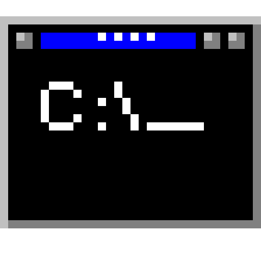

# Standard Template Constructs

Most code we write isn't new. It's the same route handler or loop or boilerplate we've written a hundred times, just with different names. Standard Template Constructs (STC) is built around that idea.

You tell it what you want in plain English. It looks through a small library of code templates, picks the one that fits best, and has a local AI model fill in the blanks for you. If nothing fits, the model writes a new template and adds it to the library, so the next time you ask for something similar, it's already there.

It all runs on your own computer. No cloud and no API bills, just a local model and a little terminal-style window.



## How it thinks

When you type a request, STC doesn't send it straight to the AI. First it does a quick, old-fashioned search: every template has a few keywords describing it, and STC compares your words against those keywords (TF-IDF with cosine similarity, if you're curious). If a template scores high enough, that's the match.

From there it depends on the mode you're in:

- **Agentic mode** (the default, green badge): STC takes the matched template and asks the AI to pull the right values out of your request. If you asked for a route at `/users`, the model figures out that `/users` belongs in the `path` slot, and you get finished code back. If nothing in the library matched, the AI writes a brand-new template and saves it.

- **Rubric mode** (red badge): no AI at all. STC hands you the closest template as-is, tells you how confident the match was, and leaves the `{placeholders}` for you to fill in. It's handy when your model isn't running, or when you'd rather do the last step yourself.

Click the badge in the top-right corner to switch modes. Your choice is remembered.

## What's in the box

```
server.py              the web server, the AI calls, and the desktop window
stc_database.py        the template library: loading, saving, searching, filling
stc_database.json.xz   the templates themselves (compressed JSON)
templates/index.html   the chat-style interface
static/                styling, front-end script, and the app icon
```

## Getting it running

You'll need **Python 3.10 or newer** and a few packages:

```bash
pip install flask flask-socketio openai scikit-learn PyQt6 PyQt6-WebEngine streamlit
```

(`streamlit` is imported but never actually used. You can install it or just delete that line from `server.py`.)

For Agentic mode, you'll also need a local model served through an OpenAI-style API at `http://localhost:8080/v1`. The code was written with `llama.cpp` and an NVIDIA Nemotron model in mind:

```bash
llama-server -m models/NVIDIA-Nemotron-3.5-Lightning-30B-A3B-Q4_0.gguf --port 8080
```

LM Studio, Ollama, vLLM, or anything else that speaks the OpenAI API will work too. Just update the address and model name near the top of `server.py`.

Then, from inside the project folder:

```bash
python server.py
```

A window pops up after a second or so. If you'd rather use your normal browser, go to `http://127.0.0.1:5002`. Type something like *"a FastAPI GET route that returns JSON"*, hit **EXEC**, and see what comes back.

## Adding your own templates

The library is just a compressed JSON file, and it's meant to be tinkered with. Each template looks like this:

```json
"api_route_handler": {
  "corpus": "fastapi route endpoint python api rest json get post",
  "slots": ["path_param", "method", "response_format"],
  "code": "def handle_route({path_param}, {method}):\n    ..."
}
```

The `corpus` is the list of words STC searches against, so the more descriptive it is, the better the matching. `slots` are the blanks, and `code` is the template, with each blank written as `{slot_name}`.

To edit it by hand:

```bash
xz -dk stc_database.json.xz    # unpack to stc_database.json
# make your changes
xz -zf stc_database.json       # pack it back up
```

One gotcha: templates are filled in with Python's `str.format`, so any real curly braces in your code (dictionaries, JavaScript blocks, and so on) need to be doubled, as `{{` and `}}`.

## Things you can tweak

- **How picky the matching is:** the `threshold` in `stc_database.py` (default `0.20`). Raise it and STC asks the AI for new templates more often. Lower it and it reuses existing ones more freely.
- **Which model it talks to:** the `base_url` and model names in `server.py`.
- **Port and window size:** also in `server.py` (port `5002`, window 1280×720).

## Rough edges

This is a work in progress, and a few things don't quite work yet. If you're picking the project up, here's where to start:

- If the AI forgets to fill a slot, rendering fails with a `KeyError` rather than degrading gracefully.
- When a new template is generated, you only see *"Creating new template..."* and never the code it made.
- If the network request fails, the chat shows the word `undefined` next to the error.

## License

There's no license yet. If you plan to share this, add one (MIT is a popular, easygoing choice).
